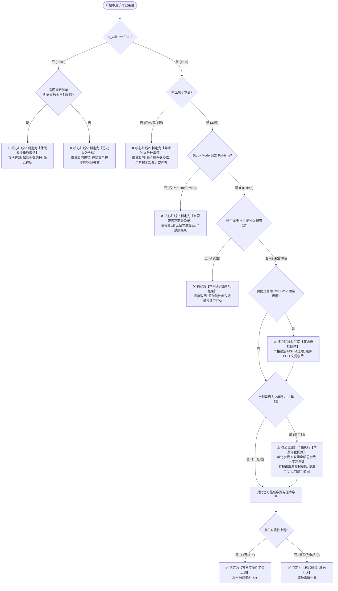

# 高校留学数据库全量质检与纠偏终审技能指南 (School Data Auditor Skill)

本 Skill 是面向高校研究生选校数据库（以中国香港顶尖名校为标杆，标准化通用适配全球高校）的**纯文字专业质检规范、业务红线法则、决策判定矩阵与 SOP 终审指南**。

深度沉淀了在**香港大学 (HKU)**、**香港中文大学 (CUHK)** 与**香港科技大学 (HKUST)** 三所大学全量核查中验证通过的**七大不可逾越的核心红线（七大军规）**，并辅以真实正反案例库。

当用户需要你核查任何学校（如港理工 PolyU、港城大 CityU、浸会 HKBU、岭南、教大或海外名校）的数据时，**请直接完整阅读本 Skill 文档，严格依照下述准则与流程执行核查与纠偏**。

---

## 一、 根本业务定位与基本常识契约

1. **核心服务对象**：
   选校系统服务的核心用户群体是**面向中国内地及海外赴目的地攻读【全日制 (Full-time) 授课型硕士 (Taught Postgraduate, TPg)】的自费留学生**。
2. **学生签证法规约束 (Entry for Study)**：
   依据各地出入境法规（如香港入境事务处政策），**国际/内地留学生必须持有学生签证，而入境处明确规定只有“全日制 (Full-time)”课程才能向非本地生提供签证担保**。纯兼读制 (Part-time Only) 在职进修班、周末模块班，留学生根本无法入境合法全日制就读，**坚决不纳入留学院校库**！
3. **入库字段标准化契约**：
   - **学费 (program_tuition)**：必须且只能统一规范为 `{数字}{币种}/年`（例如：`270000港币/年`、`428000港币/年`）。**严禁写入“/整项目”、“总学费”、“元”等非标写法**！
   - **学制 (program_duration)**：统一规范为 `{数字}年`（例如：`1年`、`1.5年`、`2年`）。
   - **申请时间 (application_time)**：优先提取 **Non-local (非本地生)** 截止日；若有提前批，统一映射为 **Round 1**；春秋双季清晰分段。
   - **有效性 (is_valid)**：`True` 表示当前学年在招主专业；`False` 表示历史停办、已合并细分方向或归档条目。

---

## 二、 终审七大核心红线（七大军规检查表）

在审查任何学校的报错或执行核对时，必须逐条过筛以下 7 大红线。**凡触碰红线者，一律直接驳回，坚决纠偏！**



---

### 🚨 核心红线 1：授课模式铁律 (Mode of Study)
**【铁律原则】**：
坚决剔除任何仅面向本地在职人士的 **Part-time only**、**EMBA (高级管理人员工商管理硕士)**、**双周在职模块班**！
- **判定标准**：
  查验官网 `Mode of Study`（或 `Study Mode`）。
  - 若标为 `Part-time only`、`Part-time (2 Years)`、`Executive` 且无任何 `Full-time` 选项：**直接判定免录，严禁提报“漏录”**！
  - 若标为 `Full-time` 或 `Full-time / Part-time`（双轨并存）：**核验全日制 Full-time 条目入库**。
- **经典案例与话术**：
  - **港科大** `Master of Science Program in Global Finance`（全球金融，NYU Stern 合办）：官网明确标示 `Mode of Study: Part-time`，学费高达 68 万港币，专为在职资深金融人士设立。实习生提报“严重漏录”，**终审驳回**！
  - **港科大** `Kellogg-HKUST EMBA`、`HKUST EMBA`、`Part-time MBA (Bi-weekly)`：学费 100~150 万，均为双周兼读制，**终审驳回**！
  - **港大** `EMBA (Executive MBA)`：双周集中授课，无全日制签证担保，**终审驳回**！

---

### 🚨 核心红线 2：校区独立性与串号防范 (Campus Integrity)
**【铁律原则】**：
异地独立办学分校（如港科大广州校区 HKUST-GZ、港中文深圳校区 CUHK-SZ 等）各自拥有独立的法人资格、独立招生章程、独立学位审批通道和独立选校库。**严禁与香港本部混杂报停办，严禁将分校专业视为本部漏录！**
- **判定标准**：
  查验 URL 域名、所属学院或校区中英文：
  - 含有 `hkust-gz.edu.cn`、`fytgs.hkust-gz`、`港科大(广州)`、`Guangzhou Campus`：归入 **HKUST(GZ) 广州校区独立库**；
  - 含有 `cuhk.edu.cn`、`cuhk-sz`、`港中文(深圳)`、`Shenzhen Campus`：归入 **CUHK(SZ) 深圳校区独立库**；
  - 含有 `uic.edu.cn`、`bnu-hkbu`、`珠海`：归入 **UIC 联合国际学院独立库**。
- **经典案例与话术**：
  - **港科大**：实习生在清水湾本部目录未查到 ID 3190（以数据为中心的人工智能技术）、ID 3205（智能制造）、ID 3223（碳中和与绿色金融）等 7 门专业，下达“虚假专业或停办下线”结论。
    **终审纠偏**：这 7 门专业是广州校区在招专业，本部自然没有，若盲目下线将导致广州校区学生前台无法检索，**坚决驳回**！
  - **港中文**：在沙田本部报称漏录金融工程硕士，实际该项目在深圳校区经管学院招生，**坚决驳回**！

---

### 🚨 核心红线 3：学费年化折算铁律 (Tuition Annualization 2.0)
**【铁律原则】**：
数据库学费格式必须且只能以 **`{数字}{币种}/年`** 呈现！遇 2 年制工学硕士 (MEng)、公共政策 (MPP)、法律博士 (JD) 或 1.5 年制专业，官网公布的往往是整项目全额总学费 (Whole Programme Tuition)，**必须除以学制年数进行年化折算**！
- **数学折算契约**：
  $$\text{入库标准年学费} = \frac{\text{官网公布整项目总学费}}{\text{学制年数 (Normative Duration)}}$$
- **判定标准**：
  当实习生提报“数据库少记了一半学费”或“官网学费为 50 多万，库里只有 20 多万”时：
  1. 立即查验专业学制 `Normative Duration`；
  2. 若为 2 年制，计算 `官网值 ÷ 2` 是否与数据库现有值一致；
  3. 若一致，**直接判定为实习生未年化反向误判，严正驳回**！库中原记录精准无误！
- **经典案例与话术**：
  - **港科大公共政策硕士 (MPP, ID: 3228)**：学制 2 年全日制，官网总学费 HK$320,000。年化折算：320,000 ÷ 2 = 160,000 港币/年。数据库原值 `160000港币/年` 100% 精确！实习生提报漏算 16 万，**终审驳回**！
  - **港科大工学硕士 (MEng AIE, ID: 3189)**：工学院人工智能与创业工学硕士，学位为工学硕士 (MEng)，学制 2 年，官网总额 HK$540,000。年化折算：540,000 ÷ 2 = 270,000 港币/年。库中原值 `270000港币/年` 精准无误，**终审驳回**！
  - **港科大设计智能工学硕士 (MEng DI, ID: 49735)**：学制 2 年，全额 HK$400,000，按年化入库 `200000港币/年`。
  - **港中文法律博士 (JD, ID: 2341)**：学制 2 年，官网总额 HK$450,000，按年化入库 `225000港币/年`，实习生拿 45 万提报少记，**终审驳回**！

---

### 🚨 核心红线 4：硕博/文凭兼挂辨析 (Degree Tier Trap)
**【铁律原则】**：
严禁将 PGD (深造文凭) 学费套在 MSc (理学硕士) 头上！严禁提取本地生受政府资助 (UGC-funded) 学费套在非本地留学生头上！
- **判定标准**：
  在工学院、社科学院等联合展示页面中：
  - `PGD` = **Postgraduate Diploma（深造文凭 / 专科文凭）**，学费低廉（通常为 10~14 万）；
  - `MSc` = **Master of Science（硕士学位）**，学费为全额（通常为 21~30 万）。
  必须以页面中标注为 **`MSc: Full-time`** 的金额为准，坚决剔除 PGD 与 Part-time 选项！
- **经典案例与话术**：
  - **港科大土木基建工程与管理 (ID: 3214)** 与 **环境工程与管理 (ID: 3224)**：官网表格同时展示 PGD (HK$105,000) 与 MSc (HK$210,000)。实习生提取了第一行出现的 10.5 万，报称数据库 21 万“虚高了 10.5 万”。
    **终审纠偏**：实习生误采了专科文凭学费，全日制硕士真实学费为 210,000 港币/年，数据库准确无误，**终审驳回**！

---

### 🚨 核心红线 5：历史失效专业免检与休眠重启智能识别 (is_valid == False)
**【铁律原则】**：
系统标有 `is_valid == False` 的条目属于历史停办、大类细分归并或清洗遗留条目，日常质检**第一原则是过滤免检**！
但必须具备**敏锐的“休眠重启 (Resumed)”洞察力**：若官网最新学年正式恢复全日制独立招生，提报管理层解除失效、重新激活！
- **免检判定标准**：
  凡属于旧细分方向（如 TCSL/TESL 合并为大类语言教育）、历史已停办专业：**严禁逐条报“时间失效”或“官网停招”，属于无效无意义报错，一律驳回**！
- **休眠重启激活标准**：
  官方发布最新学年独立招生简章，或与海外名校建立全新双学位模式：**提报“休眠专业重启激活”，采纳建档**！
- **经典案例与话术**：
  - **港科大环球海洋资源管理 (MSc GMRM, ID: 44058)**：库中原标 `is_valid=False`（因往年暂停招生而归档）。查验 2027/28 招生简章，该项目已正式与英国南安普顿大学 (University of Southampton) 开设 1 年全日制双学位 (Dual Degree) 恢复在招！
    **终审裁决**：作为特例**解除历史失效归档，激活入库更新**！
  - **港科大语言教育子方向 (ID: 3199, 3200)**：原对外汉语/英语教学子方向已合并至主专业 ID: 44059，维持失效归档，实习生报停办予以**驳回**。

---

### 🚨 核心红线 6：申请轮次与提前批标准化 (Rounds & Deadlines)
**【铁律原则】**：
提前批统一映射为 Round 1；核验严格锁定 Non-local；春秋双季清晰分段！
- **标准化规约**：
  1. **提前批即 Round 1**：官网公布的 `Early Admission Round` 或 `Advance Offer`，系统统一按第一轮即 `Round 1` 处理，后续常规轮次依次顺延。**严禁反向提报系统缺少“提前批”三个字**！
  2. **锁定 Non-local 留学生**：港校大量专业区分 Local（香港本地生）与 Non-local（非本地留学生），**一律以 Non-local 截止日期为准**，严禁误采本地生截止日。
  3. **春秋双季分流呈现**：开设春季入学的专业，格式统一为：`27年春季入学: YYYY-MM-DD | 27年秋季入学: Round 1: YYYY-MM-DD, Round 2: YYYY-MM-DD`。

---

### 🚨 核心红线 7：官方实质性学费上调核验 (Tuition Hike Approval)
**【铁律原则】**：
对官网最新公布的实质性学费上涨，严格核实全日制、非本地生、主专业三位一体，核实无误后**全额采纳，给出规范入库值**！
- **判定标准**：
  最新公布官方全额年学费大于现有库中学费，且涨幅合理（通常在 +2% ~ +25% 之间）：
  - 格式化建议入库值：`{最新官方数字}港币/年`；
  - 备注涨幅详情：`+XX,XXX 港币 (+X.X%)`。
- **经典案例**：
  - **港科大商学院**：金融科技 (ID: 3184) 39.5万 -> 40.5万 (+2.5%)；金融学 (ID: 3185) 44.88万 -> 46万 (+2.5%)；会计学 (ID: 3195) 39万 -> 42.8万 (+9.7%)；商业分析 (ID: 3192) 39.5万 -> 41.5万 (+5.1%)。
  - **港科大工学院**：EE/IC/电信三剑客 (ID: 3196, 3197, 3198) 24万 -> 29.8万 (+24.2%)；大数据 (ID: 3246) 33万 -> 35万 (+6.1%)。
  - **港大工学院**：计算机科学 (ID: 1088) 28.8万 -> 31万 (+7.6%)。

---

## 三、 标准质检 5 步 SOP 执行流水线 (Standard Operating Procedure)

无论面对哪所学校，必须严格依照以下 5 个步骤循序渐进开展：

```text
【步骤 1：数据库切片审查】
  - 导出该大学数据库全量数据 (SELECT * FROM ai_selection_programs WHERE school_name_cn = 'xxx')
  - 拆分为两个子集：在招有效池 (is_valid == True) 与 历史失效池 (is_valid == False)
  - 历史失效池预先隔离，仅用于检索“是否有休眠专业被重启”

【步骤 2：官网在招全量目录爬取】
  - 爬取该大学研究生院或各学院最新学年授课型硕士目录 (Official TPg List)
  - 过滤排除：Part-time only 课程、高管进修班、异地分校、研究型硕士博士 (MPhil/PhD)
  - 形成干净的《官网在招全日制授课型硕士基准池》

【步骤 3：大盘名单差集比对 (Diff Engine)】
  - 数据库有效池 vs 官网基准池 双向比对：
    * 完全匹配项：进入步骤 4 进行字段深度交叉比对；
    * 模糊匹配项：核实是否属于官方专业微更名或更名升级；
    * 官网独有项：重点核查是否为真实全日制“漏录”；
    * 数据库独有项：核查是否属于分校串号、历史归档未标失效或真实已停办。

【步骤 4：网页快照核查与字段多维交叉比对】
  - 针对每个专业的官网官方页面进行关键字段深度提取：
    1. Study Mode -> 再次验证是否包含 Full-time
    2. Program Duration -> 提取标准学制年数
    3. Program Tuition -> 提取 Non-local Full-time 学费，遇 2 年制必须执行年化折算除以 2
    4. Application Deadlines -> 提取 Non-local 各轮次截止日，Early Round 映射为 Round 1
    5. Language Requirements -> 提取雅思/托福总分及写作/口语小分门槛，GRE/GMAT 强制项

【步骤 5：终审裁决、纠偏过滤与高颜值反馈表生成】
  - 依据七大军规对所有差异逐条下达决策（采纳 / 驳回 / 维持）；
  - 驳回项必须附带严谨的业务红线依据与数学反推公式；
  - 采纳项必须给出标准入库格式 `{数字}{币种}/年`；
  - 生成带深蓝表头 (#1F497D)、绿色采纳高亮 (#E2EFDA)、淡粉红驳回高亮 (#F2DCDB) 的 Excel 交付件。
```

---

## 四、 常见报错快速终审判定矩阵 (Cheat Sheet)

当看到某种报错类型时，可直接查阅下表快速获得终审意见：

| 实习生/初审报错表象 | 底层真实原因探查 | 终审判定结论 | 建议处置行动 |
| :--- | :--- | :---: | :--- |
| **“某金融/高管专业官网有，数据库严重漏录”** | 查验官网 Mode of Study 为 Part-time only，专为在职人士开设 | ❌ **直接驳回** | 维持不收录。判定说明：兼读制在职高管免录，入境处无留学生签证。 |
| **“某人工智能/智能制造专业库里有，官网查无此专业，疑似停办”** | URL 或院系含有 GZ / SZ，实为广州校区或深圳校区专业 | ❌ **直接驳回** | 维持有效。判定说明：异地分校独立建档，严禁与本部混杂报停办。 |
| **“某 2 年制工科/JD 专业，官网学费比库里多了一倍，严重少记”** | 官网公布的是 2 年整项目全额总学费，数据库是折算后的年化学费 | ❌ **直接驳回** | 维持原值。判定说明：符合年化折算铁律（总额÷2=年学费），原值精准。 |
| **“某土木/环境工程专业，官网学费只有 10 万，库里 21 万虚高”** | 官网为 PGD/MSc 阶梯展示，实习生提取了第一行 PGD 专科文凭学费 | ❌ **直接驳回** | 维持原值。判定说明：严防阶梯文凭陷阱，严守 MSc 硕士学费。 |
| **“某历史哲学硕士 MPhil 专业，官网授课型目录查不到，提报停办”** | MPhil 为学术研究型学位，库中本已归档标有 is_valid=False | ❌ **直接驳回** | 维持原状免检。判定说明：历史失效条目免检，RPg 研究型免检。 |
| **“系统缺少提前批三个字，提报轮次遗漏”** | 官网标注 Early Round，系统已收录在 Round 1 | ❌ **直接驳回** | 维持原状。判定说明：Early Round 统一映射为 Round 1 顺延。 |
| **“某专业原标 is_valid=False，官网最新学年重启双学位在招”** | 历史休眠项目正式恢复全日制招生并设立双学位简章 | 🌟 **重点采纳** | 激活入库。解除失效归档状态，更新 is_valid=True 并录入最新学费。 |
| **“某在招主专业，官网最新学年学费从 39 万上调为 41.5 万”** | 官方实质性调价，且针对全日制非本地生有效 | ✅ **确凿采纳** | 采纳更新。录入最新学费 `415000港币/年`，标注上涨幅度与差额。 |
| **“某专业雅思要求从 6.0 提升至 6.5，且新增写作小分不低于 6.0”** | 官方实质性提高准入门槛 | ✅ **确凿采纳** | 采纳更新。规范更新语言要求字段，高亮小分限制。 |

---

## 五、 港大、港中文、港科大三大名校标杆案例实录 (Casebook)

本部分收录终审中具有里程碑意义的真实案例，供后续任何核查作为最高法判例援引：

### 1. 香港科技大学 (HKUST) 标杆判例
- **判例 1（年化折算反向误判）**：
  工学院人工智能与创业工学硕士（MEng AIE，ID: 3189），实习生报称“官网公布 HK$540,000，库中只有 270,000 港币/年，缩水了一半”。
  - **裁决**：**坚决驳回**！该专业为工学院 2 年制工学硕士（MEng），54 万为 2 年全额学费，年化后 27 万/年精确无误。
- **判例 2（休眠专业重启激活）**：
  理学院环球海洋资源管理（MSc GMRM，原 ID: 44058），库中原标 `is_valid=False`。实习生查实 2027/28 官方招生简章恢复招生，与英国南安普顿大学联合双学位（港科学段 14 万港币 + 南安普顿学段 1 万英镑）。
  - **裁决**：**全员表彰并正式采纳**！解除历史归档，激活建档入库！
- **判例 3（高管兼读制免录）**：
  全球金融（MSc GFIN）、凯洛格-港科大 EMBA，学制 1~1.5 年，学费 68~154 万港币。
  - **裁决**：**坚决驳回**！`Mode of Study: Part-time`，无学生签证，严禁入库。

### 2. 香港中文大学 (CUHK) 标杆判例
- **判例 1（JD 年化折算）**：
  法律博士（JD，ID: 2341），官网公布总学费 HK$450,000，学制为 2 年全日制。
  - **裁决**：**坚决驳回**！45 万 ÷ 2 = 22.5 万港币/年，原库记录 `225000港币/年` 完全符合规范，严禁直接把 45 万写入年学费。
- **判例 2（异地校区混淆）**：
  金融工程理学硕士（MSc FE），实习生报称沙田本部官网目录查无此项，提报漏录。
  - **裁决**：**坚决驳回**！该专业属香港中文大学（深圳）经管学院在招专业，独立归入深圳校区库维护。

### 3. 香港大学 (HKU) 标杆判例
- **判例 1（EMBA 兼读制误报漏录）**：
  高级管理人员工商管理硕士（EMBA），双周集中授课模块，仅限本地高管或持工作签人士就读。
  - **裁决**：**坚决驳回**！严格锁定 Full-time 全日制授课型硕士，不收录在职 EMBA。
- **判例 2（历史失效条目免检）**：
  数据库中 36 条历史停办或旧细分条目标有 `is_valid=False`。
  - **裁决**：**严守免检隔离原则**！禁止对失效数据提报无意义的“停招”或“时间失效”，集中精力核查在招主专业。

---

## 六、 当用户要求你核查新学校时的执行指令

当你被用户要求“核查某所大学（如香港理工大学 PolyU、香港城市大学 CityU、浸会大学 HKBU 等）”时，请严格遵照以下步骤：

1. **自动调取本 Skill 的七大军规**；
2. **检查输入数据**：
   - 提取数据库切片（分离 `is_valid=True` 与 `False`）；
   - 提取官方在招清单或实习生提报差异；
3. **逐项执行红线判定**：
   - 发现 Part-time / EMBA -> 输出【驳回：兼读制高管免录】；
   - 发现分校混入 -> 输出【驳回：异地独立分校串号】；
   - 发现 2年制/1.5年制拿总额报差额 -> 输出【驳回：学费年化折算反向误判，附带数学公式】；
   - 发现 PGD 文凭学费冒充 MSc -> 输出【驳回：误采文凭学费张冠李戴】；
   - 发现历史失效盲检 -> 输出【驳回：历史失效免检】；
   - 发现休眠重启 -> 输出【🌟重点采纳：休眠专业重启激活】；
   - 发现官方实质调价 -> 输出【✅终审采纳：官方实质性学费上调，附带规范值与涨幅】；
4. **生成交付件**：
   - 输出清晰的统计看板（提报总数、采纳数、驳回数、采纳率）；
   - 生成符合深蓝表头规范的格式化 Excel 差异反馈表供用户直接交付。
