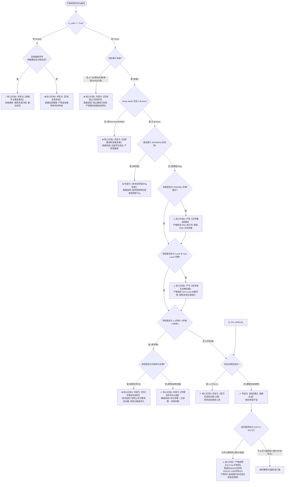

# 高校留学数据库全量质检与纠偏终审技能指南 (School Data Auditor Skill v2.0)

本 Skill 是面向高校研究生选校数据库（以中国香港六大顶尖名校 HKU、CUHK、HKUST、PolyU、CityU、HKBU 为标杆，标准化通用适配全球高校）的**纯文字专业质检规范、业务红线法则、决策判定矩阵、10 列交付契约与 SOP 终审指南**。

深度沉淀了在**港大、港中文、港科大、港理工、港城大、港浸会**六所大学全量实战核查中总结验证通过的**七大不可逾越的核心红线（七大军规 2.0 版）**，并辅以详实的六大名校标杆真实判例库。

当用户需要你核查任何学校（如港八大、澳门高校、新加坡及英美澳等海外名校）的数据时，**请直接完整阅读本 Skill 文档，严格依照下述准则与流程执行核查与纠偏**。

---

## 一、 根本业务定位与基本常识契约

1. **核心服务对象**：
   选校系统服务的核心用户群体是**面向中国内地及海外赴目的地攻读【全日制 (Full-time) 授课型硕士 (Taught Postgraduate, TPg)】的自费留学生**。
2. **学生签证法规约束 (Entry for Study)**：
   依据各地出入境法规（如香港特别行政区入境事务处政策），**国际/内地留学生必须持有学生签证，而入境处明确规定只有“全日制 (Full-time)”课程才能向非本地生提供签证担保**。纯兼读制 (Part-time Only) 在职进修班、周末高管模块班，留学生根本无法入境合法全日制就读，**坚决不纳入留学院校库**！
3. **入库字段标准化契约**：
   - **学费 (`program_tuition`)**：必须且只能统一规范为 `{数字}{币种}/年`（例如：`270000港币/年`、`428000港币/年`、`150000人民币/年`）。**严禁写入“/整项目”、“总学费”、“元”等非标写法**！
   - **学制 (`program_duration`)**：统一规范为 `{数字}年`（例如：`1年`、`1.5年`、`2年`、`3年`）。
   - **申请时间 (`application_time`)**：优先提取 **Non-local (非本地生)** 截止日；若有提前批，统一映射为 **Round 1**；春秋双季清晰分段。
   - **有效性 (`is_valid`)**：`True` 表示当前学年在招主专业；`False` 表示历史停办、已合并细分方向或归档条目。
4. **质检交付表 10 列铁律契约 (Strict 10-Column Schema)**：
   全量质检与差异核对交付件（Excel Sheet 2）的列结构必须**严格限制为 10 列**，表头顺序与命名如下：
   `[专业ID, 院校名称, 专业英文名称, 专业中文名称, 字段英文名称, 字段中文名称, 原值, 建议值, 差异类型, 差异说明]`
   > [!CAUTION]
   > **绝对严禁私自新增第 11 列（如“审批意见”、“审核结论”、“质检人”等）！** 终审裁决与反推依据必须完整收敛在第 10 列“差异说明”中，任何超出 10 列的表格均属于严重格式违规！

---

## 二、 终审七大核心红线（七大军规检查表 2.0）

在审查任何学校的报错或执行核对时，必须逐条过筛以下 7 大红线。**凡触碰红线者，一律直接驳回，坚决纠偏！**



---

### 🚨 核心红线 1：授课模式铁律 (Mode of Study)
**【铁律原则】**：
坚决剔除任何仅面向本地在职人士的 **Part-time only**、**EMBA (高级管理人员工商管理硕士)**、**双周在职模块班**！
- **判定标准**：
  查验官网 `Mode of Study`（或 `Study Mode`）。
  - 若标为 `Part-time only`、`Part-time (2 Years)`、`Executive`、`Modular` 且无任何 `Full-time` 选项：**直接判定免录，严禁提报“漏录”**！
  - 若标为 `Full-time` 或 `Full-time / Part-time`（双轨并存）：**核验全日制 Full-time 条目入库**。
- **经典案例与话术**：
  - **港科大** `Master of Science Program in Global Finance`（全球金融，NYU Stern 合办）：官网明确标示 `Mode of Study: Part-time`，学费高达 68 万港币，专为在职资深金融人士设立。实习生提报“严重漏录”，**终审驳回**！
  - **港科大** `Kellogg-HKUST EMBA`、`HKUST EMBA`、`Part-time MBA (Bi-weekly)`：学费 100~150 万，均为双周兼读制，**终审驳回**！
  - **港大** `EMBA (Executive MBA)`：双周集中授课，无全日制签证担保，**终审驳回**！
  - **港城大 / 港浸会** `EMBA`：均为高级管理人员在职进修班，不招收全日制国际留学生，**终审驳回**！

---

### 🚨 核心红线 2：异地独立分校与独立学院防串号体系 (Campus Integrity)
**【铁律原则】**：
异地独立办学分校（如港科大广州、港中文深圳、港城大东莞、港浸会 UIC）及独立自资二级学院（如港理工 SPEED）各自拥有独立的法人资格、招生章程、学位审批通道和独立选校库。**严禁与香港本部混杂报停办，严禁将分校/独立学院专业视为本部漏录！**
- **五大异地分校与独立学院全景识别矩阵**：
  1. **香港科技大学(广州) (HKUST-GZ)**：
     - 识别特征：域名 `hkust-gz.edu.cn`、`fytgs.hkust-gz`、院系含“广州校区”、“红鸟硕士”；
     - 归属：归入 **HKUST(GZ) 独立校区库**，严禁提报清水湾本部停办或漏录。
  2. **香港中文大学(深圳) (CUHK-SZ)**：
     - 识别特征：域名 `cuhk.edu.cn`、`cuhk-sz`、院系含“深圳校区”、“港中深经管/理工学院”；
     - 归属：归入 **CUHK(SZ) 独立校区库**，严禁与沙田本部混杂。
  3. **香港城市大学(东莞) (CityU-DG)**：
     - 识别特征：域名 `cityu-dg.edu.cn`、校区位于东莞松山湖；
     - 关键参数：学制通常为 2 年，学费为 `110000~160000人民币/年`，CET-6 门槛 425 分；
     - 归属：归入 **香港城市大学(东莞) 独立库**（目前已有 10 项在招与 3 项历史条目），严禁报九龙塘本部停办。
  4. **北京师范大学-香港浸会大学联合国际学院 (HKBU-UIC, 珠海)**：
     - 识别特征：域名 `uic.edu.cn`、`gs.uic.edu.cn`、`bnbu`、校区位于广东珠海；
     - 关键参数：学制 1~2 年，学费为 `145000~280000人民币/年`，CET-6 门槛 430 分，申请截止日通常 Rolling 至 5月/6月；
     - 归属：归入 **UIC 独立校区库**（目前有 10 项在招专业），严禁报浸会九龙塘本部漏录或停招。
  5. **香港理工大学专业进修学院 (PolyU SPEED)**：
     - 识别特征：域名 `speed-polyu.edu.hk`，属 PolyU 专上学院 (CPCE) 体系，开设 16 门自资硕士；
     - 归属：独立建档，严禁与红磡主校区 (Hung Hom Main Campus) 官网目录混淆。

---

### 🚨 核心红线 3：学费年化折算与调价双轨核验 (Tuition Annualization 2.0)
**【铁律原则】**：
数据库学费格式必须且只能以 **`{数字}{币种}/年`** 呈现！对于 1.5 年制、2 年制或 3 年制专业，官网公布的往往是整项目全额总学费 (Whole Programme Total Tuition)，**必须除以学制年数进行年化折算**！同时必须严密甄别**“反向误判”**与**“真实纠偏”**！

- **数学折算与学分折算公式**：
  $$\text{入库标准年学费} = \frac{\text{官网公布整项目总学费}}{\text{学制年数 (Normative Duration)}}$$
  $$\text{港理工工科年学费} = \frac{\text{总学分数 (如 31 学分)} \times \text{每学分费用}}{1.5}$$

- **两大审查分支辨析（反向误判 vs 真实纠偏）**：
  1. **【分支 A：反向误判坚决驳回】**：
     - 表象：实习生提报“官网学费比库里多了一倍，数据库严重少记”、“官网 40~55 万，库中只有 18~27 万”。
     - 核查：若该专业为 2 年制或 3 年制（如建筑 MArch、城市规划 MUD、社会工作 MSW、艺术硕士 MFA、法律博士 JD），且 `官网总额 ÷ 学制` 恰好等于数据库现有值。
     - 裁决：**坚决判定为实习生反向误判，严肃驳回！原库记录精准无误！**
  2. **【分支 B：真实年化纠偏确凿采纳】**：
     - 表象：历史录入人员粗心大意，将 1.5 年制或 2 年制专业的全额总学费原封不动填入了年学费字段。
     - 典型场景：
       * **港理工 18 门工学硕士**：1.5 年全日制，整项目 31 学分总学费（HK\$195,300 或 HK\$186,000）被原库直接填为了年学费。必须纠偏折算为：$195,300 \div 1.5 = 130,200 \text{ 港币/年}$（或 $186,000 \div 1.5 = 124,000 \text{ 港币/年}$）！
       * **港浸会创业与环球营销 (MScEGM, ID: 8377)**：15 个月制（1.5 年），官网总学费 HK\$298,000 被原库误填为年学费。必须纠偏折算为：$298,000 \div 1.5 = 198,667 \text{ 港币/年}$！
     - 裁决：**判定为【官方学费真实年化纠偏】，确凿采纳更新！**

- **实质性学费上调规则**：
  若官方对全日制非本地生学费进行实质性上调（通常涨幅在 +2% ~ +25%），核实无误后**确凿采纳**，输出 `{最新官方数字}港币/年`，并附带涨幅百分比与绝对差额。

---

### 🚨 核心红线 4：文凭兼挂辨析与非本地生双轨学费防雷 (Degree Tier & Non-Local Trap)
**【铁律原则】**：
严禁将 PGD (深造文凭) 学费套在 MSc (理学硕士) 头上！**严禁将本地生受政府资助 (UGC-funded/Local) 的学费套在非本地自费留学生 (Non-Local) 头上！**

- **防雷场景 1：PGD 与 MSc 阶梯混挂**：
  - `PGD` = **Postgraduate Diploma（深造文凭）**，学费低廉（约 10~14 万）；
  - `MSc` = **Master of Science（硕士学位）**，学费为全额（约 21~32 万）。
  - 必须严格锁定 **`MSc: Full-time`** 对应金额，剔除 PGD 干扰！
- **防雷场景 2：Local 本地生 vs Non-Local 非本地生双轨学费**：
  - 港校（尤其商学院、计算机、数据科学）普遍推行双轨学费定价：
    * **港浸会商业管理 (MScBM, ID: 8378)**：本地生 HK\$301,000，非本地留学生 HK\$393,000；
    * **港浸会资讯科技管理 (MScITM, ID: 8387)**：本地生 HK\$220,000，非本地留学生 HK\$260,000；
    * **港浸会数据分析与人工智能 (MSDAAI, ID: 43570)**：本地生 HK\$260,000，非本地留学生 HK\$300,000。
  - 实习生若误采 Local 低学费提报数据库“虚高”，**必须严厉驳回**！留学院校库必须 100% 维护 Non-Local 自费学费！

---

### 🚨 核心红线 5：历史失效专业免检与休眠重启智能识别 (`is_valid == False`)
**【铁律原则】**：
系统标有 `is_valid == False` 的条目属于历史停办、大类细分归并或旧制改版归档条目，日常质检**第一原则是过滤免检**！但必须具备**敏锐的“休眠重启 (Resumed)”洞察力**！

- **免检判定标准**：
  凡属于旧细分方向（如 TCSL/TESL 合并为语言教育大类）、历史已停招专业（如浸会历史 3 年制 MFA ID: 8404 改制为 2 年制 MFA ID: 43569）：**严禁逐条报“时间失效”或“官网停招”，属于无效无意义报错，一律驳回**！
- **休眠重启激活标准**：
  官方发布最新学年独立招生简章，或与海外名校建立全新双学位模式（如港科大环球海洋资源管理 MSc GMRM 与英国南安普顿大学联合双学位重启）：**提报“休眠专业重启激活”，解除归档采纳建档**！

---

### 🚨 核心红线 6：申请轮次与提前批标准化 (Rounds & Deadlines)
**【铁律原则】**：
提前批统一映射为 Round 1；核验严格锁定 Non-local；春秋双季清晰分段！
- **标准化规约**：
  1. **提前批即 Round 1**：官网公布的 `Early Admission Round`、`Priority Round` 或 `Advance Offer`，系统统一按第一轮即 `Round 1` 处理，后续常规轮次依次顺延。**严禁反向提报系统缺少“提前批”三个字**！
  2. **锁定 Non-local 留学生**：一律以 Non-local 截止日期为准，严禁误采本地生截止日。
  3. **春秋双季分流呈现**：开设春季入学的专业，格式统一为：`27年春季入学: YYYY-MM-DD | 27年秋季入学: Round 1: YYYY-MM-DD, Round 2: YYYY-MM-DD`。

---

### 🚨 核心红线 7：语言准入门槛与大学英语六级 (CET-6) 认可矩阵
**【铁律原则】**：
**坚决纠正“香港所有大学都不承认大学英语六级 (CET-6)”的错误常识！** 香港城市大学与香港浸会大学官方明确认可 CET-6 作为合规语言成绩，必须严格依据各院校、各学院的分级门槛进行核查！

- **大学英语六级 (CET-6) 官方认可矩阵**：
  | 院校/校区 | 院系/专业分类 | CET-6 门槛要求 | 对应雅思/托福标准 | 质检核对与纠偏指示 |
  | :--- | :--- | :---: | :---: | :--- |
  | **香港城市大学 (CityU)** | 常规大多数专业 (商学院/工学院/理学院/社科等) | **CET-6: 450 分** | 雅思 6.5 / 托福 79 | 官方标准认可，严禁将六级成绩报为“非法/无效”！ |
  | **香港城市大学 (CityU)** | **法学院 (JD, LLM, LLM Arb 仲裁争议解决)** | **CET-6: 520 分 (特高门槛)** | 雅思 7.0 / 托福 100 | **法学院独立高门槛**！误填 450 分者必须纠偏为 520 分！ |
  | **香港城市大学(东莞)** | 东莞校区所有硕士专业 | **CET-6: 425 分** | 雅思 6.5 / 托福 79 | 东莞校区独立门槛，核对为 425 分。 |
  | **香港浸会大学 (HKBU)** | **文学院与翻译学** (Faculty of Arts & Translation) | **CET-6: 500 分** | 雅思 6.5 / 托福 79 | 文学院语言文学类高门槛，严格核验 500 分。 |
  | **香港浸会大学 (HKBU)** | **社会科学院** (Social Work, Public Admin 等) | **CET-6: 480 分** | 雅思 6.5 / 托福 79 | 社科学院门槛为 480 分。 |
  | **香港浸会大学 (HKBU)** | 商学院、理学院、传理学院主流专业 | **CET-6: 450 分** | 雅思 6.0~6.5 / 托福 74~79 | 标准认可，核对为 450 分。 |
  | **香港浸会大学(UIC)** | 珠海研究生院各专业 | **CET-6: 430 分** | 雅思 5.5~6.0 / 托福 65~79 | UIC 独立门槛，核验 430 分。 |
  | **港大 / 港中文 / 港科大** | 全校授课型硕士 | **不认可六级 (N/A)** | 雅思 6.5+ / 托福 80+ | 必须持有有效雅思或托福，若有六级报错应予剔除。 |
  | **香港理工大学 (PolyU)** | 红磡主校区绝大多数专业 | **不认可六级 (N/A)** | 雅思 6.0+ / 托福 80+ | 主校区标准化为雅思 6.0 / 托福 80。 |

---

## 三、 标准质检 5 步 SOP 执行流水线 (Standard Operating Procedure)

无论面对哪所大学，必须严格依照以下 5 个步骤循序渐进开展，确保交付质量达到 100% 零差错：

```text
【步骤 1：数据库切片审查】
  - 导出该大学数据库全量数据 (SELECT * FROM ai_selection_programs WHERE school_name_cn = 'xxx' AND degree = '硕士')
  - 剔除同名/类似名称海外高校（如查询“浸会”必须精确过滤排除美国达拉斯浸会大学 27 条干扰项）
  - 拆分为两个子集：在招有效池 (is_valid == True) 与 历史失效池 (is_valid == False)
  - 历史失效池预先隔离，仅用于检索“是否有休眠专业被重启”

【步骤 2：官网在招全量目录爬取】
  - 爬取该大学研究生院或各学院最新学年授课型硕士目录 (Official TPg List)
  - 严格过滤排除：Part-time only 课程、高管进修班 (EMBA)、异地分校、研究型硕士博士 (MPhil/PhD)
  - 形成干净的《官网在招全日制授课型硕士基准池》

【步骤 3：大盘名单差集比对 (Diff Engine)】
  - 数据库有效池 vs 官网基准池 双向比对：
    * 完全匹配项：进入步骤 4 进行字段深度交叉比对；
    * 模糊匹配项：核实是否属于官方专业微调更名（如“智能制造”与“智能制造工程”）；
    * 官网独有项：重点核查是否为真实全日制“漏录”，或是异地分校/在职高管误入；
    * 数据库独有项：核查是否属于分校串号、历史归档未标失效或真实停办。

【步骤 4：网页快照核查与字段多维交叉比对】
  - 针对每个专业的官网官方页面进行关键字段深度提取与核对：
    1. Study Mode -> 再次验证是否包含 Full-time；
    2. Program Duration -> 提取标准学制年数 (1年 / 1.5年 / 2年 / 3年)；
    3. Program Tuition -> 提取 Non-local Full-time 学费：
       - 若原库已年化且一致 -> 核验通过；
       - 若原库误填整项目总额 -> 触发【真实年化纠偏】除以学制；
       - 若实习生拿整项目总额报差额 -> 触发【反向误判驳回】；
       - 若官方实质上调 -> 触发【官方实质调价】采纳；
    4. Application Deadlines -> 提取 Non-local 各轮次截止日，提前批映射为 Round 1；
    5. Language Requirements -> 提取雅思、托福，以及城大/浸会的 CET-6 分级分数门槛。

【步骤 5：终审裁决、10列交付表生成与指导报告撰写】
  - 依据七大军规对所有差异逐条下达决策（采纳 / 驳回 / 维持）；
  - 严格交付标准 Excel 工作簿：
    * Sheet 1: 基础数据库切片全量清单；
    * Sheet 2: 质检核对与差异终审表（严格 10 列，深蓝表头 #1F497D，绿色采纳高亮 #E2EFDA，粉红驳回高亮 #F2DCDB，绝对无第 11 列！）；
  - 编写深度《实习生质检反馈与纠偏指导报告.md》，附带数学公式、红线条款与指导评语。
```

---

## 四、 常见报错快速终审判定矩阵 (Cheat Sheet 2.0)

当看到某种报错类型时，可直接查阅下表快速获得终审意见：

| 实习生/初审报错表象 | 底层真实原因探查 | 终审判定结论 | 建议处置行动与规范话术 |
| :--- | :--- | :---: | :--- |
| **“某金融/高管专业官网有，数据库严重漏录”** | 官网 Mode of Study 为 Part-time only / Executive，专为在职人士开设 | ❌ **直接驳回** | **驳回：兼读制在职高管免录**。入境处无全日制留学生签证担保，坚决不收录。 |
| **“某人工智能/智能制造/碳中和专业库里有，官网本部查无此项，提报停办”** | URL 域名含有 gz / sz / dg / uic，实为广州、深圳、东莞或珠海分校专业 | ❌ **直接驳回** | **驳回：异地独立分校串号**。各分校独立建档维护，严禁与本部混杂报停办。 |
| **“某 2 年制建筑/规划/社工/艺术或 3 年制 JD，官网学费比库里多了一倍，严重少记”** | 官网公布的是 2~3 年整项目总学费，数据库是已完成年化折算的年学费 | ❌ **直接驳回** | **驳回：学费年化折算反向误判**。符合年化铁律（总额÷学制=年学费），原库精准无误。 |
| **“某 1.5 年制工科/商科专业，库中学费为 19.5 万或 29.8 万，年学费偏高”** | 历史建库将 1.5 年全额总学费误写入年学费，未执行除以 1.5 年化折算 | ✅ **确凿采纳** | **采纳：官方学费真实年化纠偏**。执行公式：总学费 ÷ 1.5，录入标准年化学费。 |
| **“某商学院/计算机专业，官网学费只有 22~30 万，数据库 26~39 万虚高”** | 实习生提取了本地生 (Local) 受资助学费，忽视了非本地生 (Non-Local) 真正学费 | ❌ **直接驳回** | **驳回：误采本地生学费张冠李戴**。选校库核心服务留学生，严守 Non-Local 学费。 |
| **“某土木/环境工程专业，官网学费只有 10 万，库里 21 万虚高”** | 官网页面为 PGD/MSc 阶梯展示，实习生提取了第一行出现的 PGD 专科文凭学费 | ❌ **直接驳回** | **驳回：误采文凭学费张冠李戴**。严防阶梯文凭陷阱，严守 MSc 全日制硕士学费。 |
| **“某城大/浸会专业录入了 CET-6 成绩，提报语言类型错误或非法”** | 城大与浸会官方明确接受大学英语六级，符合院校官方招生简章规定 | ❌ **直接驳回** | **驳回：六级认可常识违规**。城大与浸会官方正规认可 CET-6，维持合规入库。 |
| **“某城大法学院专业（JD/LLM），实习生将六级门槛修改为 450 分”** | 城大法学院官方对 CET-6 具有 520 分特高门槛要求，450 分严重误导学生 | ❌ **驳回纠偏** | **纠偏采纳：法学院六级 520 特高门槛**。统一修正为 `CET-6: 520`，严防误报。 |
| **“某历史条目标有 is_valid=False，提报时间过期或停办下线”** | 该专业本属于大类合并历史归档条目，日常免检 | ❌ **直接驳回** | **驳回：历史失效条目免检**。严守隔离免检原则，禁止报无意义的过期。 |
| **“某专业原标 is_valid=False，官网最新学年恢复全日制独立在招并设双学位”** | 历史休眠项目正式恢复全日制招生 | 🌟 **重点采纳** | **采纳：休眠专业重启激活**。解除失效归档，更新 `is_valid=True` 并录入最新参数。 |
| **“某在招主专业，官网最新学年学费从 30 万上调至 33 万”** | 官方实质性调价，且针对全日制非本地生有效 | ✅ **确凿采纳** | **采纳：官方实质性学费上调**。录入最新学费 `{最新数字}港币/年`，标注涨幅与差额。 |
| **“交付表格中增加了‘审批意见’或‘审核结论’一列”** | 违反严格 10 列交付契约 | ❌ **直接驳回** | **格式违规：坚决删除第 11 列**！严格遵循 10 列标准结构交付。 |

---

## 五、 六大名校标杆实战判例库 (Universal Casebook)

本部分收录香港六所顶尖名校终审中的里程碑判例，供后续任何高校核查作为最高法判例援引：

### 1. 香港大学 (HKU) 标杆判例
- **判例 1（EMBA 兼读制误报漏录）**：
  高级管理人员工商管理硕士（EMBA），双周集中授课模块，仅限本地在职高管就读。
  - **终审裁决**：**坚决驳回**！严格锁定 Full-time 全日制授课型硕士，不收录在职 EMBA。
- **判例 2（历史失效条目免检）**：
  数据库中 36 条历史停办或旧细分条目标有 `is_valid=False`。
  - **终审裁决**：**严守免检隔离原则**！禁止对失效数据提报无意义的“停招”或“时间失效”。

### 2. 香港中文大学 (CUHK) 标杆判例
- **判例 1（JD 年化折算反向误判）**：
  法律博士（JD，ID: 2341），官网公布整项目总学费 HK\$450,000，学制为 2 年全日制。实习生提报少记 22.5 万。
  - **终审裁决**：**坚决驳回**！$450,000 \div 2 = 225,000 \text{ 港币/年}$，原库记录完全精准，严禁直接把整项目总额填入年学费！
- **判例 2（异地校区混淆）**：
  金融工程理学硕士（MSc FE），实习生报称沙田本部官网目录查无此项，提报漏录。
  - **终审裁决**：**坚决驳回**！该专业属香港中文大学（深圳）经管学院在招专业，独立归入深圳校区库维护。

### 3. 香港科技大学 (HKUST) 标杆判例
- **判例 1（工科 MEng 年化折算反向误判）**：
  工学院人工智能与创业工学硕士（MEng AIE，ID: 3189），官网公布 2 年总额 HK\$540,000。实习生提报“官网 54 万，库中只有 27 万，严重缩水”。
  - **终审裁决**：**坚决驳回**！该专业为工学院 2 年制工学硕士（MEng），$540,000 \div 2 = 270,000 \text{ 港币/年}$，年化学费精确无误！
- **判例 2（休眠专业重启激活）**：
  理学院环球海洋资源管理（MSc GMRM，原 ID: 44058），库中原标 `is_valid=False`。查实最新招生简章与英国南安普顿大学联合双学位正式恢复全日制在招。
  - **终审裁决**：**全员表彰并正式采纳**！解除历史失效归档，激活建档入库！
- **判例 3（高管兼读制免录）**：
  全球金融（MSc GFIN）、凯洛格-港科大 EMBA，学制 1~1.5 年，学费 68~154 万港币，标为 Part-time。
  - **终审裁决**：**坚决驳回**！`Mode of Study: Part-time`，无学生签证，严禁入库。

### 4. 香港理工大学 (PolyU) 标杆判例
- **判例 1（1.5 年制工科 31 学分总学费真实年化纠偏）**：
  土木工程 (ID: 8180)、电气工程 (ID: 8186)、机械工程 (ID: 8206) 等 18 门工学硕士，学制 1.5 年全日制，总学分 31 Credits，官网全额总学费 HK\$195,300（或 HK\$186,000）。历史建库误将 19.5 万总学费直接填入年学费。
  - **终审裁决**：**确凿采纳并真实年化纠偏**！执行年化折算：$195,300 \div 1.5 = 130,200 \text{ 港币/年}$（或 $186,000 \div 1.5 = 124,000 \text{ 港币/年}$），坚决纠正历史存量错误！
- **判例 2（PolyU SPEED 独立自资学院混淆防范）**：
  专业进修学院 (PolyU SPEED, `speed-polyu.edu.hk`，属 CPCE 体系)，开设 16 门自资硕士。实习生在红磡主校区官网未查到，提报“16 门专业停办”。
  - **终审裁决**：**坚决驳回**！SPEED 为独立自资学院，独立建档，严禁与本部红磡主校区混杂报停办。
- **判例 3（医疗康复与临床专业 2 年制年化核对）**：
  医疗化验科学 (MSc MLS, ID: 8225)、物理治疗 (MPT)、作业治疗 (MOT) 等 2 年制专业，总学费 39 万。
  - **终审裁决**：原库已年化入库 `195000港币/年`，驳回实习生拿 39 万报差额的误判，维持原值！

### 5. 香港城市大学 (CityU) 标杆判例
- **判例 1（东莞校区 CityU-DG 独立建档防雷）**：
  香港城市大学(东莞) (`cityu-dg.edu.cn`) 拥有独立法人，库中有 10 项在招专业（计算机、材料、智能制造等，学制 2 年，学费 11~16 万人民币/年，六级 425 分）。实习生在九龙塘本部未查到，提报全部停办下线。
  - **终审裁决**：**坚决驳回**！东莞校区独立建档，学费以人民币结算，严禁与本部混淆报停办！
- **判例 2（2 年制建筑/规划/社工/艺术与 3 年制 JD 反向误判驳回）**：
  建筑学 (MArch, ID: 4122, 2年, 总额 47.8万, 库中 23.9万/年); 城市设计与区域规划 (MUD, ID: 43577, 2年, 总额 52.2万, 库中 26.1万/年); 社会工作 (MSW, ID: 4104, 2年, 总额 39万, 库中 19.5万/年); 创意媒体 (MFA, ID: 4132, 2年, 总额 41万, 库中 20.5万/年); 法律博士 (JD, ID: 4078, 3年全日制, 总额 55.2万, 库中 18.4万/年)。实习生提报数据库“少记了 20~36 万”。
  - **终审裁决**：**坚决驳回**！数据库原值完全符合 $478,000 \div 2 = 239,000$、$552,240 \div 3 = 184,000$ 等年化公式，原值精准，严禁拿总额报差额！
- **判例 3（法学院六级 CET-6 520 分特高门槛核验）**：
  法学院 JD (ID: 4078)、LLM (ID: 4079)、仲裁及争议解决 (ID: 4080) 官方明确规定 CET-6 必须达到 **520 分**（或雅思 7.0）。实习生将全校常规 450 分套入法学院。
  - **终审裁决**：**终审纠偏采纳**！准确录入法学院独立特高门槛 `CET-6: 520`，全校其他专业维持 `CET-6: 450`。

### 6. 香港浸会大学 (HKBU) 标杆判例
- **判例 1（UIC 珠海联合国际学院独立建档与滚动截止日防雷）**：
  北师港浸大 (UIC, `gs.uic.edu.cn`) 库中有 10 门在招专业（传播学、AI与数字媒体、社会工作等，学费 14.5万~28万人民币/年，六级 430 分，Rolling 截止）。实习生在九龙塘本部查无此项报停办。
  - **终审裁决**：**坚决驳回**！UIC 独立建档，严禁与九龙塘本部混杂报错！
- **判例 2（15 个月制创业与环球营销 MScEGM 真实年化折算）**：
  创业与环球营销理学硕士 (MScEGM, ID: 8377)，学制 15 个月（1.5 年），官网总额 HK\$298,000。原库误填为年学费 29.8 万。
  - **终审裁决**：**确凿采纳并真实年化纠偏**！按 1.5 年折算：$298,000 \div 1.5 = 198,667 \text{ 港币/年}$，消除虚高，规范入库！
- **判例 3（历史 3 年制 MFA 归档与新 2 年制 MFA 区分辨析）**：
  电影电视与数码媒体艺术硕士 (MFA, 旧 ID: 8404 为历史 3 年制，库中标 `is_valid=False`；新 ID: 43569 为改制后全新 2 年制，总额 HK\$436,000，年化 21.8万/年)。实习生提报旧条目停招或试图篡改旧条目。
  - **终审裁决**：**坚决驳回**！旧条目免检归档，新项目已由新 ID 独立承接，严禁篡改历史归档数据！
- **判例 4（商学院与计算机 Local vs Non-Local 双轨学费防雷）**：
  商业管理 (MScBM, ID: 8378, 本地 30.1万 vs 非本地 39.3万); 资讯科技管理 (MScITM, ID: 8387, 本地 22万 vs 非本地 26万); 数据分析与人工智能 (MSDAAI, ID: 43570, 本地 26万 vs 非本地 30万)。实习生按本地生学费提报数据库虚高。
  - **终审裁决**：**坚决驳回**！自费留学库必须锁定 Non-Local 全额学费，严禁使用本地生受资助学费！

---

## 六、 当用户要求你核查新学校时的执行指令

当你被用户要求“核查某所大学（如香港各校、澳门高校、新加坡公立大学、英国罗素集团、澳洲八大等）”的数据或报错时，请严格遵照以下步骤执行：

1. **自动读取并调取本 Skill 的七大军规 2.0**；
2. **提取并隔离输入数据**：
   - 提取数据库切片（严格分离 `is_valid=True` 在招池 与 `is_valid=False` 历史失效池）；
   - 提取官方在招清单或实习生提报差异；
3. **逐项执行红线穿透判定**：
   - 发现 Part-time only / EMBA -> 输出【驳回：兼读制在职高管免录】；
   - 发现异地分校/独立学院混入 -> 输出【驳回：异地独立分校串号】；
   - 发现 1.5年/2年/3年制拿总额报差额 -> 输出【驳回：学费年化折算反向误判，附带数学反推公式】；
   - 发现 1.5年/2年制原库误填总额 -> 输出【✅采纳：学费真实年化纠偏，按学制除算入库】；
   - 发现误采本地生 (Local) 学费 -> 输出【驳回：误采本地生学费张冠李戴】；
   - 发现 PGD 文凭学费冒充 MSc -> 输出【驳回：误采文凭学费张冠李戴】；
   - 发现城大/浸会六级成绩报错 -> 输出【驳回：六级认可常识违规，按矩阵核查门槛】；
   - 发现历史失效盲目报错 -> 输出【驳回：历史失效专业免检】；
   - 发现休眠重启 -> 输出【🌟重点采纳：休眠专业重启激活】；
   - 发现官方全日制非本地生实质调价 -> 输出【✅终审采纳：官方实质性学费上调，附带规范值与涨幅】；
4. **生成严格 10 列交付 Excel 工作簿**：
   - Sheet 1: 基础数据库切片全量清单；
   - Sheet 2: 质检核对与差异终审表（**严格 10 列，绝对无第 11 列“审批意见”**，深蓝表头，红绿高亮清晰）；
5. **编写结构化纠偏指导报告**：
   - 输出清晰的统计看板（核查总数、采纳数、驳回数、采纳率）；
   - 逐条列出裁决理由、官方佐证依据与严密计算推导。
