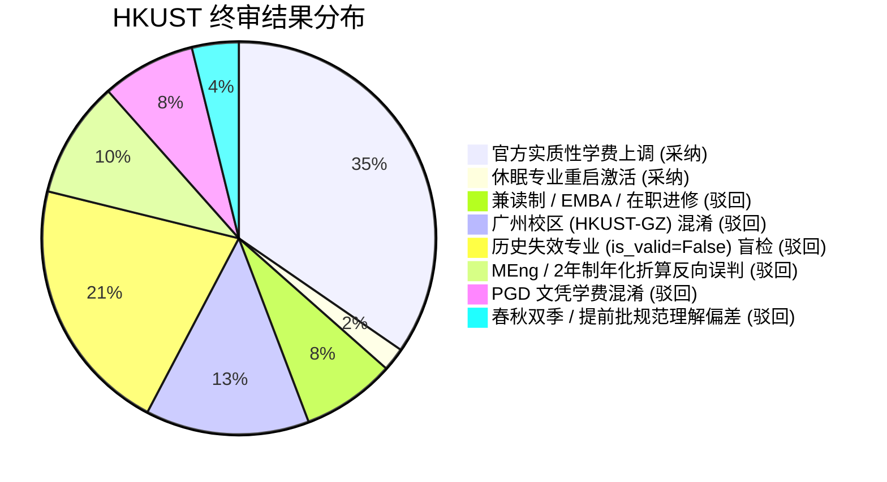
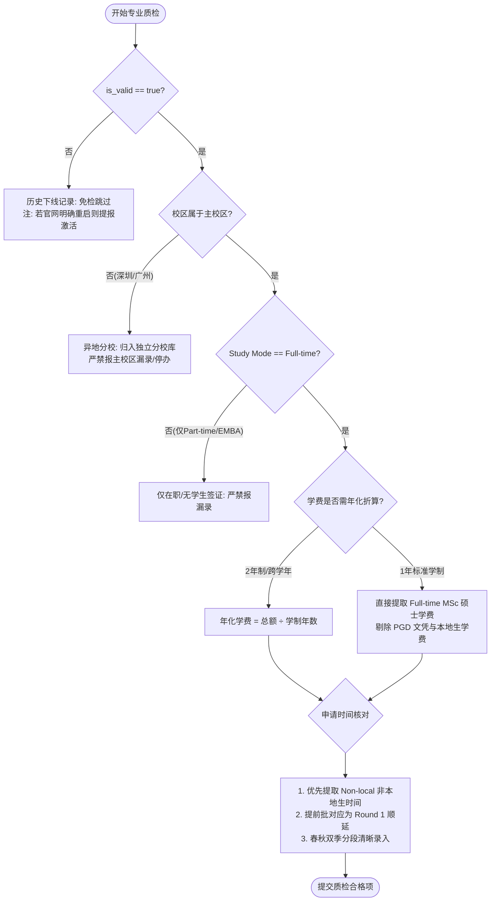

# 📋 【香港科技大学 (HKUST)】数据质检终审反馈与纠偏指导报告（实习生交付与进阶改良版）

> **致数据质检实习生**：
> 本次香港科技大学（HKUST）的数据核对工作已完成管理层终审。在本次核查中，大家展现了极高的敬业度和敏锐的数字嗅觉，成功挖掘出了商学院（金融科技、会计、金融等）、工学院（EE、IC、电信、大数据等）及人文社科学院等多达 **18 门专业的 2027/28 官方实质性学费上调**，并敏锐发现了理学院环球海洋资源管理（MSc GMRM）在 2027/28 正式**休眠重启（Resumed）在招**的关键动态，表现非常出色！
>
> 与此同时，结合此前在香港大学（HKU）与香港中文大学（CUHK）质检中暴露的共性问题，本次在**异地校区双轨招生机制、2年制工学硕士（MEng）年化折算、硕博/文凭兼挂阶梯学费、以及春秋双季开学轮次规约**等更深层次的业务场景中，依然出现了典型误判。
>
> 为了系统性固化港校质检方法论，真正做到“做一所学校、通一类体系”，特在港大、港中文两份报告的基础上**全面改良与进阶升级**，整理出本份深度复盘报告与 3.0 版标准化通关指南。

---

## 一、 本次终审核心数据大盘与采纳率统计

| 统计指标 | 数值 | 占比说明 |
| :--- | :--- | :--- |
| **实习生提报差异总数** | **52 项** | 包含漏录 16 项、学费未更新 24 项、学制年化异议 5 项、轮次与提前批 5 项、停办异议 2 项 |
| **管理层终审采纳（Approved）** | **19 项** | 确凿 2027/28 学费上调（18 门）、全日制休眠专业重启建档（1 门）（**有效采纳率：36.5%**） |
| **管理层终审驳回（Rejected）** | **33 项** | 包含兼读制/在职高管误报（4 项）、广州校区串号（7 项）、历史失效盲检（11 项）、年化折算反向误判（5 项）、文凭学费张冠李戴（4 项）、春秋季轮次错位（2 项）（**驳回率：63.5%**） |



---

## 二、 进阶复盘：为什么你的报错被驳回？六大典型误区与业务红线深度剖析（改良升级版）

---

### 🚨 核心红线 1：严禁将兼读制 / 高管在职进修（Part-time / EMBA）报为“漏录”（本次驳回 4 项）

- **实习生报错**：
  在步骤 3 比对中发现数据库未收录商学院以下 4 门专业，强烈判定为“严重漏录”：
  1. `Master of Science Program in Global Finance`（全球金融理学硕士，与纽约大学斯特恩商学院 NYU Stern 合办）
  2. `HKUST Executive Master of Business Administration Program`（港科大 EMBA 高管工商管理硕士）
  3. `Kellogg-HKUST Executive Master of Business Administration Program`（凯洛格-港科大 EMBA）
  4. `Part-time Master of Business Administration Program (Bi-weekly)`（双周兼读制 MBA）
- **根本业务红线与政策契约**：
  **选校系统底层铁律：核心服务对象是面向中国内地及海外赴港留学的【全日制（Full-time）】授课型硕士！**
  依据香港入境事务处（Immigration Department）法规，**内地留学生赴港就读必须持有学生签证（Entry for Study），而入境处明确规定只有全日制（Full-time）课程才能提供学生签证担保**！纯兼读制（Part-time Only）在职课程学费高达 50~150 万港币，授课安排在周末或模块化集中授课，仅面向拥有本地身份、在港工作签（IANG）或跨国企业高管，留学生根本无法入境就读，**坚决不纳入全日制留学院校库**！
- **官网真实属性查验（硬核抓包核验）**：
  - `msc-gfin`：官网页面 `Mode of Study` 明确标示为 **Part-time**，学制 1 年，学费高达 HK$682,500（87,500 美元），为在职金融高管模块班；
  - `hkust-emba` 与 `kh-emba`：学制 16~18 个月，学费高达 HK$1,280,000 与 HK$1,540,000，`Mode of Study` 明确为 **Part-time**；
  - `pt-mba-biweekly`：专业英文名称中直接带由 **`Part-time`** 字段，学制 24 个月。
- **SOP 避坑指南**：
  查看任何专业官网时，**第一眼必须看 `Mode of Study`**！只要写着 `Part-time only`、`EMBA` 或无全日制选项的项目，一律不用检查，**严禁上报漏录**！

---

### 🚨 核心红线 2：严禁跨校区串号！香港科技大学（广州）HKUST(GZ) 独立建档，严禁与清水湾本部混杂（本次驳回 7 项）

- **实习生报错**：
  实习生在比对清水湾本部官网目录时，提报：
  - “数据库中收录的 `数据中心人工智能技术`（ID: 3190）、`智能制造`（ID: 3205）、`碳中和与绿色金融`（ID: 3223）、`创新创业 MBA`（ID: 3229）、`科技与政策`（ID: 3231）、`红鸟跨学科 MPhil`（ID: 3242）、`计算艺术 MFA`（ID: 11586）在港科大官网查无此专业，属于库中虚假专业或疑似停办！”
- **底层业务认知盲区剖析**：
  **香港科技大学（广州）与香港科技大学（清水湾）是独立办学实体，各自拥有独立的招生章程、独立学位审批与独立管理系统！**
  - 清水湾本部官网：`https://prog-crs.hkust.edu.hk/pgprog`
  - 广州校区霍英东研究生院官网：`https://fytgs.hkust-gz.edu.cn/`
  这 7 门在招硕士在系统库中是以 `HKUST(GZ)` 广州校区身份独立建档招生，招生与就读地点在广州南沙，官网自然不会出现在香港清水湾本部的目录中！
- **严重危害**：
  如果实习生单凭清水湾本部目录，就给广州校区的专业下达“疑似停办/下线”的结论，会直接导致内地申请广州校区的学生无法在前台选校检索，造成灾难性业务损失！
- **SOP 避坑指南**：
  在核对院校数据前，**先核查 URL 域名与校区属性**！凡含有 `hkust-gz.edu.cn`、`cft.hkust-gz`、中文校区含“广州”的，统一归入 `数据库独有(广州校区/独立招生)` 独立维护，**严禁将其视为清水湾本部的漏录或停办**。

---

### 🚨 核心红线 3：【学费折算铁律 2.0】2年制工学硕士（MEng）与公共政策（MPP）必须年化除以学制！（本次驳回 5 项）

- **实习生报错**：
  对工学院新设立的人工智能与创业工学硕士（ID: 3189）、设计智能工学硕士（ID: 49735）及公共政策硕士（ID: 3228）报称：
  - “公共政策硕士（MPP，ID: 3228）数据库学费标为 160,000港币/年，但官网明确写着 HK$320,000，少报了 16 万，属于严重漏算！”
  - “工学院人工智能与创业工学硕士（MEng AIE，ID: 3189）官网写着 HK$540,000，库中却只有 270,000港币/年，缩水了一半！”
- **底层业务契约与数学复盘**：
  **系统学费标准必须且只能以 `{数字}{币种}/年` 呈现，任何整项目/跨学年总学费必须按学制折算为年化学费！**
  - **公共政策硕士（MPP，ID: 3228）**：
    查验港科大公共政策学院官网，MPP 为 **标准 2 年制（2-year Full-time）** 专业！官网公布的 HK$320,000 为 2 年总学费。
    年化折算公式：
    $$\text{年学费} = \frac{\text{HK\$ } 320,000}{2 \text{ 年}} = 160,000 \text{ 港币/年}$$
    **数据库记录的 `160000港币/年` 不仅没有任何错误，而且 100% 精确符合系统规范！**
  - **人工智能与创业工学硕士（MEng AIE，ID: 3189）**：
    该项目是工学院设立的 **工学硕士（Master of Engineering，MEng）**，其学位学制为 **2 年制（Normative Duration: 2 years）**，官网公布的 HK$540,000 为 2 年全额学费。
    年化折算公式：
    $$\text{年学费} = \frac{\text{HK\$ } 540,000}{2 \text{ 年}} = 270,000 \text{ 港币/年}$$
    数据库原值 `270000港币/年` 同样精准无误！实习生直接拿 2 年总额报差额属于**严重反向误判**。
  - **设计智能工学硕士（MEng DI，ID: 49735）**：
    学制同样为 2 年制 MEng，全额学费 HK$400,000，按年化除以 2 折算为 `200000港币/年`。
- **SOP 避坑指南**：
  在核验学费前，**必须先看 `Normative Program Duration`（学制时长）**！凡是学制标注为 2 年、1.5 年的，必须将总学费除以年数换算为每学年学费；**严禁擅自用整项目总额覆盖系统年学费，严禁带“/整项目”非标写法**！

---

### 🚨 核心红线 4：严防“硕博/文凭兼挂”陷阱，严禁将 PGD（文凭）学费套在 MSc（硕士）头上（本次驳回 4 项）

- **实习生报错**：
  土木与环境工程系《土木基建工程与管理理学硕士》（ID: 3214）与《环境工程与管理理学硕士》（ID: 3224），实习生报称：
  - “官网最新学费公布为 HK$105,000，数据库记录的 210,000 港币/年虚高了 10.5 万！”
- **真实页面陷阱揭露（DOM 结构复原）**：
  在港科大工学院及社科学院官网，部分项目采取 **硕博文凭连读或阶梯招生（PGD / MSc）联合展示页面**：
  ```html
  <div class="block-table-row">
      <div class="block-row-title">Program Fee</div>
      <div class="block-row-content">
          PGD: Full-time: HK$105,000 | Part-time: HK$105,000
          MSc: Full-time: HK$210,000 | Part-time: HK$180,000
      </div>
  </div>
  ```
  - `PGD` 为 **Postgraduate Diploma（深造文凭）**，学费为 HK$105,000；
  - `MSc` 为 **Master of Science（理学硕士）**，学费为 HK$210,000！
- **翻车根源**：
  实习生使用自动化脚本或肉眼初审时，只提取了第一行出现的数字（PGD 的 105,000），误把专科文凭当成了硕士学费上报。
- **SOP 避坑指南**：
  对于名称带 `Postgraduate Diploma and Master of Science` 的专业，**必须严格核对 `MSc` 硕士对应的项**，坚决剔除 PGD（文凭）及 Part-time 本地生资助学费！

---

### 🚨 核心红线 5：历史失效专业（`is_valid == false`）免检，但需敏锐识别“休眠重启”（本次驳回 11 项，纠偏采纳 1 项）

- **实习生报错**：
  - 对 15 门广州校区早期历史归档 MPhil（ID: 3182, 3186 等）逐一报告时间失效；
  - 对清水湾旧语言教育两个方向（ID: 3199, 3200）报告停办。
- **业务红线复核**：
  系统底层标有 `is_valid == False` 的专业均属于历史下线数据（例如早期数据清洗遗留的细分方向），**执行质检时第一原则是过滤 `is_valid == False` 免检**！
- **深度亮点与反向突破（特例表彰）**：
  在本次核查中，理学院《环球海洋资源管理理学硕士》（MSc in Global Marine Resources Management，ID: 44058）在数据库中原标为 `is_valid=False`（因 2025/26 暂停招生而归档）。
  但经实习生与官网 2027/28 招生简章交叉比对，**该项目已正式与英国南安普顿大学（University of Southampton）以 1 年全日制双学位（Dual Degree）形式全面重启在招**！
- **管理层处置**：
  针对该项目，管理层正式采纳实习生建议，**将其从历史失效表中解除休眠，重新激活入库**！这是非常高水准的数据纠偏，值得全员学习！

---

### 🚨 核心红线 6：春秋双季开学与提前批标准化规范（本次驳回 2 项）

- **业务契约**：
  - **春季（Spring）与秋季（Fall）双季分流**：港科大工学院及理学院部分专业开设春季入学（如每年 2 月入学，截止日一般在上年 11 月）与秋季入学（9 月入学，截止日在次年 6 月）。系统在 `application_time` 字段中已明确采用 `27年春季入学: ... | 27年秋季入学: ...` 分段表示；
  - **提前批统一为 Round 1**：与港大、港中文一致，官网标注的 `Early Admission Round`，系统统一按第一轮即 `Round 1` 处理，后续依次顺号，**严禁反向提报系统缺少“提前批”三个字**。

---

## 三、 终审采纳清单：本次核查确认采纳的 19 项有效更新

经过管理层终审查验，以下 **19 项数据更新确凿有效**，已正式纳入港科大最终更新交付表：

### 1. 2027/28 官方实质性学费上调（共 18 门）

全部已按照 `{数字}港币/年` 标准入库：

| 专业 ID | 学院 / 方向 | 英文专业全称 | 库中原学费 | 2027/28 官方最新学费 | 差额 / 涨幅 |
| :---: | :--- | :--- | :---: | :---: | :---: |
| **3184** | 商学院 | Master of Science in Financial Technology (金融科技) | 395,000港币/年 | **405,000港币/年** | +10,000 (+2.5%) |
| **3185** | 商学院 | Master of Science in Finance (金融学) | 448,800港币/年 | **460,000港币/年** | +11,200 (+2.5%) |
| **3192** | 商学院 | Master of Science in Business Analytics (商业分析) | 395,000港币/年 | **415,000港币/年** | +20,000 (+5.1%) |
| **3193** | 商学院 | Master of Science in Economics (经济学) | 330,000港币/年 | **350,000港币/年** | +20,000 (+6.1%) |
| **3195** | 商学院 | Master of Science in Accounting (会计学) | 390,000港币/年 | **428,000港币/年** | +38,000 (+9.7%) |
| **3209** | 商学院 | Master of Science in Marketing (市场营销) | 380,000港币/年 | **400,000港币/年** | +20,000 (+5.3%) |
| **3220** | 商学院 | Master of Science in Global Operations (全球运营) | 340,000港币/年 | **365,000港币/年** | +25,000 (+7.4%) |
| **3221** | 商学院 | Master of Science in International Management (国际管理) | 390,000港币/年 | **420,000港币/年** | +30,000 (+7.7%) |
| **3191** | 工学院 | Master of Science in Information Technology (信息技术) | 300,000港币/年 | **320,000港币/年** | +20,000 (+6.7%) |
| **3196** | 工学院 | Master of Science in Electronic Engineering (电子工程) | 240,000港币/年 | **298,000港币/年** | +58,000 (+24.2%) |
| **3197** | 工学院 | Master of Science in Integrated Circuits (集成电路) | 240,000港币/年 | **298,000港币/年** | +58,000 (+24.2%) |
| **3198** | 工学院 | Master of Science in Telecommunications (电信) | 240,000港币/年 | **298,000港币/年** | +58,000 (+24.2%) |
| **3246** | 工学院 | Master of Science in Big Data Technology (大数据技术) | 330,000港币/年 | **350,000港币/年** | +20,000 (+6.1%) |
| **3211** | 工学院 | Master of Science in Chemical and Energy Engineering (化学与能源) | 208,000港币/年 | **229,000港币/年** | +21,000 (+10.1%) |
| **3247** | 工学院 | Master of Science in Biomolecular Engineering (生物分子工程) | 208,000港币/年 | **229,000港币/年** | +21,000 (+10.1%) |
| **3248** | 理学院 | Master of Science in Biotechnology (生物技术) | 142,000港币/年 | **168,000港币/年** | +26,000 (+18.3%) |
| **3245** | 理学院 | Master of Science in Analytical Chemistry (分析化学) | 160,000港币/年 | **170,000港币/年** | +10,000 (+6.3%) |
| **44059** | 社科学院 | Master of Arts in International Language Education (国际语言教育) | 135,000港币/年 | **165,000港币/年** | +30,000 (+22.2%) |

### 2. 重点全日制休眠专业重启激活（1 门）

- 🌟 **理学院环球海洋资源管理（MSc GMRM，原 ID: 44058）**：
  - **最新招生模式**：与英国南安普顿大学（University of Southampton）联合双硕士学位（Dual Degree）；
  - **学制与学费**：Full-time 1 年，港科大学段学费 HK$140,000 + 南安普顿学段学费 £10,000；
  - **处置结论**：正式解除历史失效归档状态，激活建档入库！

---

## 四、 进阶改良版：“高校数据质检 3.0 通关避坑 Checklist”（SOP 落地标准）

在开启下一所大学（如香港城市大学 CityU、香港理工大学 PolyU 等）的数据质检前，请全员严格依照此流程卡点自检：



### 📋 终极通关 7 大军规检查表

- [ ] **1. 验校区属性（Campus Integrity）**：是否属于主校区？对带有 `(GZ)`、`SZ`、`广州`、`深圳` 的分校专业，**严禁混入主校区报漏录或虚假停办**！
- [ ] **2. 验授课模式（Mode of Study）**：是否提供 **Full-time**？凡写着 `Part-time only`、`EMBA`、高管在职研讨班的，**一律严禁报漏录**！
- [ ] **3. 查数据库全量（Slice Query）**：报漏录前，是否用完整英文名、关键词、学位缩写在 `db_slice` 做过精准搜索？严禁把已入库专业报成漏录！
- [ ] **4. 严守年化折算（Tuition Annualization）**：遇到 MEng（2年制）、MPP（2年制）或 1.5 年制专业，**是否已除以学制年数**？入库标准必须是 `{数字}{币种}/年`，严禁写“/整项目”！
- [ ] **5. 防范文凭兼挂（Degree Tier Differentiation）**：对于 `PGD / MSc` 合并说明页面，**是否准确提取了 MSc 硕士考项**，而未误采 PGD 文凭考分与学费？
- [ ] **6. 提前批对应 Round 1（Standard Rounding）**：官网公布的 Early Admission Round，系统统一对应为第一轮即 `Round 1`，原有轮次依次顺延，**严禁反向提报系统缺少“提前批”**！
- [ ] **7. 非本地生双轨时间（Non-local Only）**：对区分 Local 与 Non-local 的专业，**一律以 Non-local（留学生）截止日为准**；春秋双季开学严格分段呈现！
